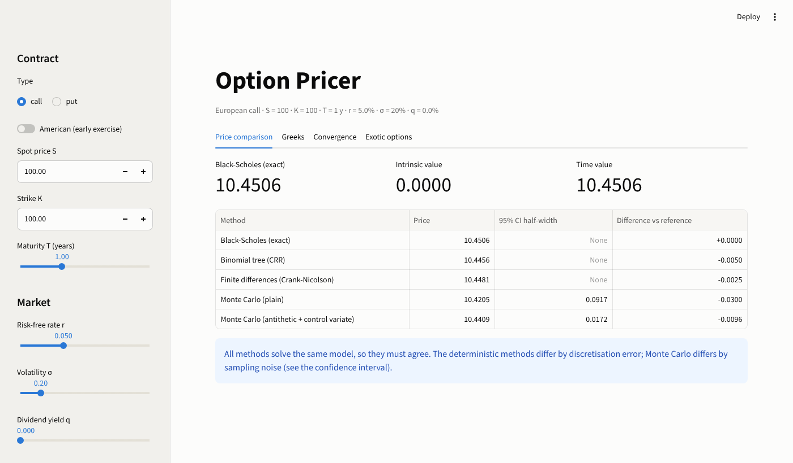
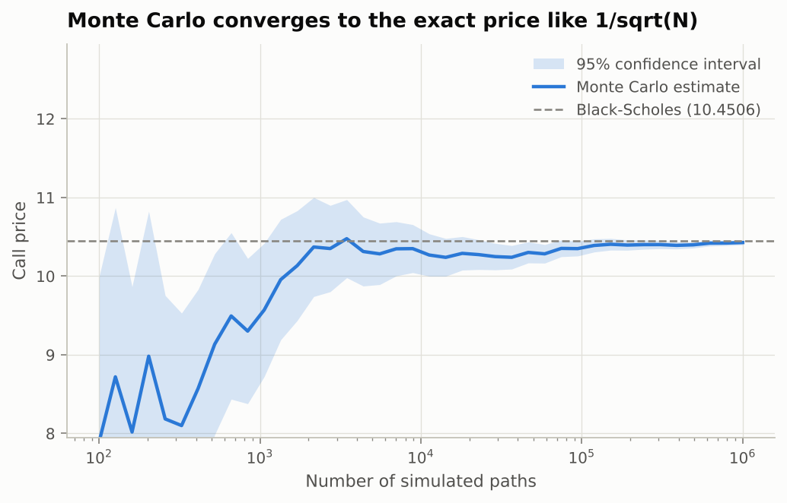
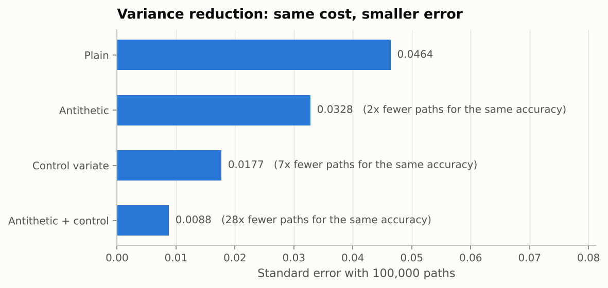
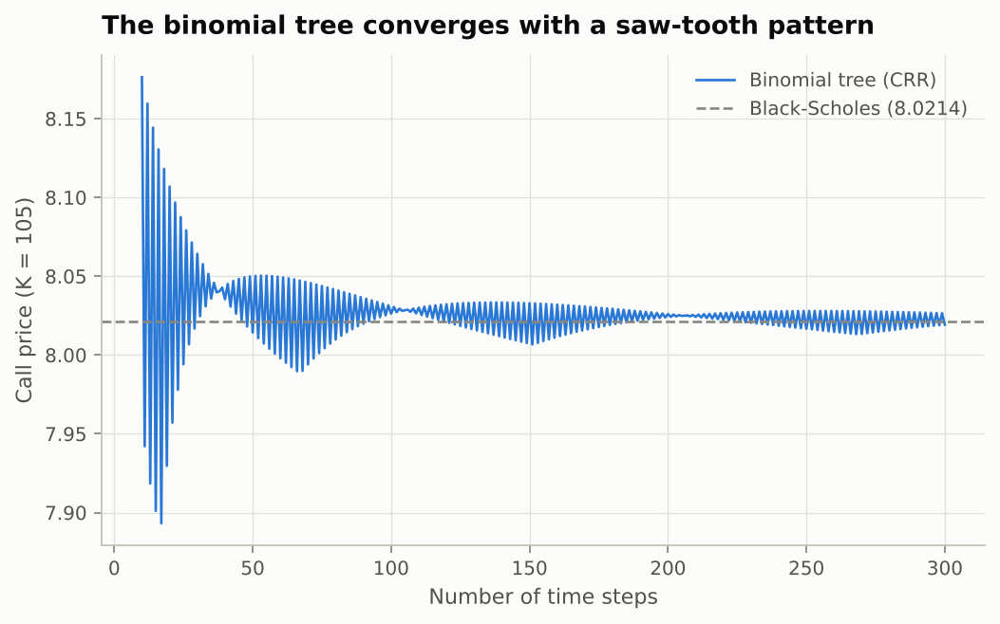
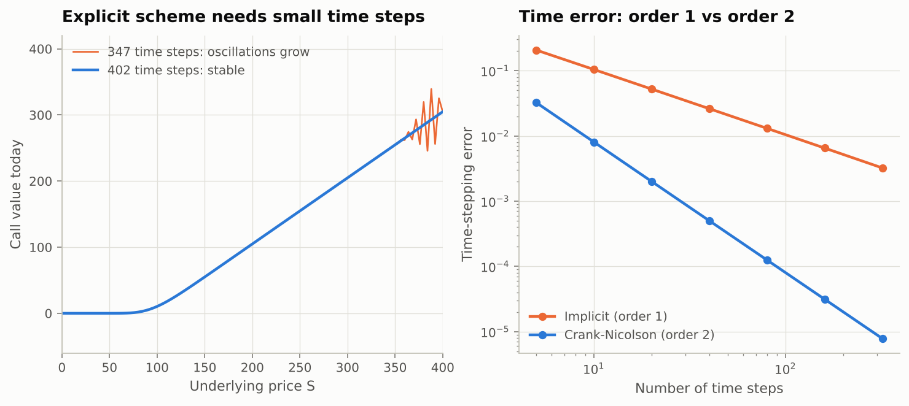
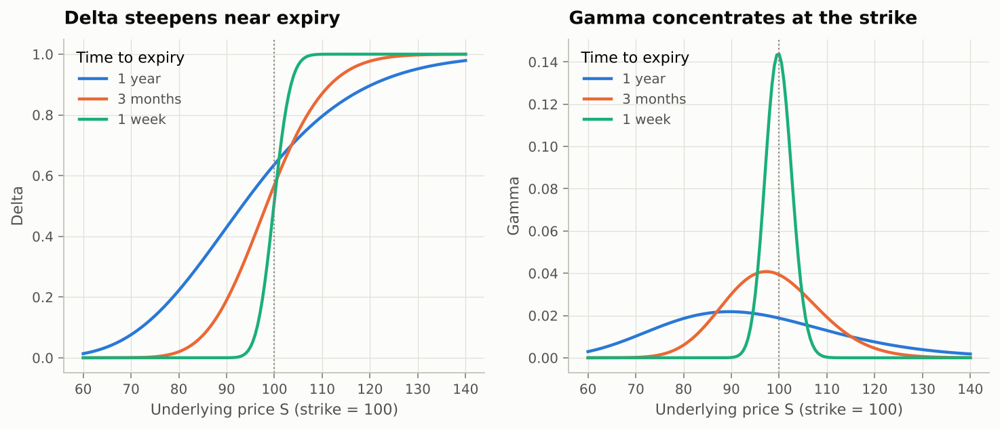
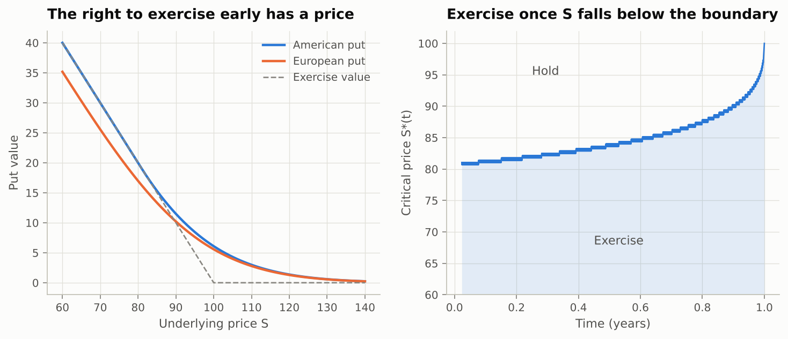
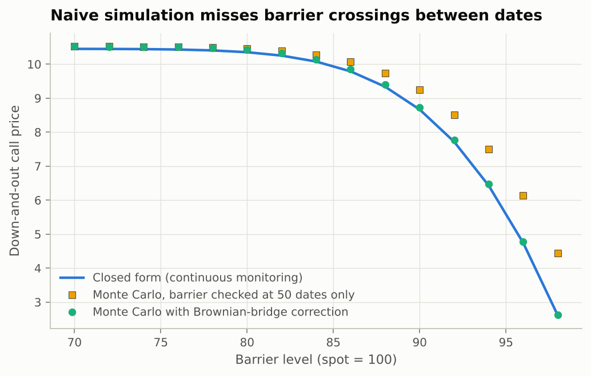

# Option Pricer

Pricing of vanilla and exotic options with four independent numerical methods, cross-validated against each other and against closed-form solutions.

| Method | Module | Handles |
|---|---|---|
| Black-Scholes closed form | `pricer/black_scholes.py` | European options, Greeks, implied volatility |
| Monte Carlo simulation | `pricer/monte_carlo.py` | European options, variance reduction, pathwise and likelihood-ratio Greeks |
| Binomial tree (Cox-Ross-Rubinstein) | `pricer/binomial.py` | European and American options, early-exercise boundary |
| Finite differences (explicit, implicit, Crank-Nicolson) | `pricer/finite_difference.py` | European, American and knock-out barrier options |
| Exotic options | `pricer/exotics.py` | Asian, barrier, American by Longstaff-Schwartz |



## Results

All numbers below are for the reference contract S = 100, K = 100, T = 1 year, r = 5%, σ = 20%, and can be reproduced with the notebooks.

### Every method agrees on the price

| Method | European call | Difference |
|---|---|---|
| Black-Scholes (exact) | 10.4506 | |
| Binomial tree, 1,000 steps | 10.4486 | -0.0020 |
| Crank-Nicolson, 800 x 800 grid | 10.4500 | -0.0006 |
| Monte Carlo, 200,000 paths | 10.4634 ± 0.0649 | +0.0128 |
| Monte Carlo with variance reduction, 200,000 paths | 10.4388 ± 0.0122 | -0.0118 |

Monte Carlo intervals are 95% confidence intervals.

### Monte Carlo converges like 1/√N, and variance reduction makes up for it





Combining antithetic variates with a control variate gives the accuracy of plain Monte Carlo with about 28 times fewer paths. For an Asian option, using the geometric-average option as control variate divides the variance by about 1,300.

### The binomial tree converges with a saw-tooth pattern



### The Black-Scholes PDE behaves like the heat equation

A change of variables turns the Black-Scholes PDE into the heat equation, so it inherits the same numerical behaviour: the explicit scheme is stable only below a time-step limit proportional to ΔS², while the implicit and Crank-Nicolson schemes are unconditionally stable. Crank-Nicolson is second order in time.



### Greeks



Closed-form Greeks are checked against bump-and-revalue on every pricer and against Monte Carlo estimators.

### American options

| Method | American put |
|---|---|
| Binomial tree, 2,000 steps | 6.0900 |
| Crank-Nicolson, 800 x 800 grid | 6.0889 |
| Longstaff-Schwartz, 200,000 paths, 50 exercise dates | 6.0695 ± 0.0189 |
| European put (Black-Scholes), for comparison | 5.5735 |

Longstaff-Schwartz sits slightly below the tree because it allows exercise at 50 dates only and uses an estimated exercise rule.



### Barrier options: simulation needs a correction

A simulated path is observed at a finite number of dates and misses barrier crossings in between. For a down-and-out call with barrier 90, the naive simulation gives 9.05 where the exact price is 8.67. Weighting each step by the Brownian-bridge survival probability removes the bias.

| Method | Down-and-out call, H = 90 |
|---|---|
| Closed form (Reiner-Rubinstein) | 8.6655 |
| Finite differences | 8.6653 |
| Monte Carlo with Brownian-bridge correction | 8.6828 ± 0.0637 |
| Monte Carlo, barrier checked at 100 dates only | 9.0466 |



## Installation

```bash
git clone https://github.com/AminD/option-pricer-reference.git
cd option-pricer-reference
python -m venv .venv
.venv\Scripts\activate          # Windows
# source .venv/bin/activate     # macOS / Linux
pip install -r requirements.txt
```

## Usage

### Python

```python
from pricer import VanillaOption, black_scholes, binomial, monte_carlo, finite_difference, exotics

option = VanillaOption(spot=100, strike=100, maturity=1.0, rate=0.05, vol=0.2, option_type="call")

black_scholes.price(option)                      # 10.4506
black_scholes.greeks(option)                     # delta, gamma, vega, theta, rho
binomial.price(option, n_steps=1000)             # 10.4486
finite_difference.price(option)                  # Crank-Nicolson by default
monte_carlo.price(option, n_paths=200_000, seed=42, antithetic=True, control_variate=True)

put = option.with_(option_type="put")
binomial.price(put, n_steps=2000, american=True)                 # 6.0900
exotics.american_price_lsm(put, n_paths=200_000, seed=6)         # Longstaff-Schwartz
exotics.asian_price(option, n_fixings=50, seed=1)                # arithmetic Asian
exotics.barrier_price_analytic(option, 90.0, "down-and-out")     # 8.6655
```

### Command line

```bash
python -m pricer --spot 100 --strike 100 --maturity 1 --rate 0.05 --vol 0.2 --type call
python -m pricer --spot 100 --strike 110 --maturity 1 --rate 0.05 --vol 0.2 --type put --american
```

```
European call: S=100 K=100 T=1 r=0.05 sigma=0.2 q=0

Method                           Price     vs ref.
----------------------------------------------------
Black-Scholes (exact)          10.4506               reference
Binomial tree (CRR)            10.4466     -0.0040
Finite differences (CN)        10.4490     -0.0016
Monte Carlo (plain)            10.4634     +0.0128   +/- 0.0649
Monte Carlo (reduced var.)     10.4388     -0.0118   +/- 0.0122
```

### Dashboard

```bash
streamlit run app/streamlit_app.py
```

The dashboard prices any contract with every method, shows the Greeks, the convergence of each method, and the exotic options.

### Tests and figures

```bash
pytest                           # 85 tests
python scripts/make_figures.py   # regenerate the figures of this README
```

## Project structure

```
pricer/                  the library
  options.py             contract and market parameters
  black_scholes.py       closed-form price, Greeks, implied volatility
  monte_carlo.py         simulation, variance reduction, Monte Carlo Greeks
  binomial.py            Cox-Ross-Rubinstein tree
  finite_difference.py   theta-scheme PDE solver
  greeks.py              bump-and-revalue Greeks for any pricer
  exotics.py             Asian, barrier and American (Longstaff-Schwartz)
  plotting.py            shared Matplotlib style
  cli.py                 command-line interface
app/streamlit_app.py     interactive dashboard
notebooks/               four notebooks with the full analysis
tests/                   test suite
docs/theory.md           mathematical derivations
scripts/make_figures.py  regenerates docs/figures
```

## Notebooks

1. [Black-Scholes and Monte Carlo](notebooks/01_black_scholes_and_monte_carlo.ipynb): put-call parity, convergence rate, variance reduction.
2. [Binomial tree and Greeks](notebooks/02_binomial_tree_and_greeks.ipynb): convergence, American options, three ways to compute Greeks.
3. [Finite differences](notebooks/03_finite_differences.ipynb): link with the heat equation, stability, order of convergence.
4. [Exotic options](notebooks/04_exotic_options.ipynb): Asian, barrier and Longstaff-Schwartz.

The derivations behind the code are in [docs/theory.md](docs/theory.md).

## How the results are validated

No number in this project relies on a single method:

- Black-Scholes prices satisfy put-call parity to machine precision, and the Greeks match finite differences of the price.
- The tree, the PDE solver and Monte Carlo are each tested against Black-Scholes.
- American prices from the tree, the PDE and Longstaff-Schwartz are tested against each other.
- Barrier closed forms are tested against the PDE and against simulation, and knock-in plus knock-out equals the vanilla price.
- The geometric Asian closed form is tested against direct simulation.
- Monte Carlo tests use fixed seeds and compare to the exact value within four standard errors.

## Model assumptions and limits

The underlying follows a geometric Brownian motion with constant volatility and interest rate, and a continuous dividend yield. Real markets show a volatility smile that this model cannot reproduce; calibrating a stochastic-volatility model (Heston) to market quotes is the natural next step. The American treatment in the PDE solver (projection after each step) is first order in time.

## References

- J. Hull, *Options, Futures, and Other Derivatives*.
- P. Glasserman, *Monte Carlo Methods in Financial Engineering*.
- P. Wilmott, *Paul Wilmott Introduces Quantitative Finance*.
- F. Longstaff and E. Schwartz, "Valuing American Options by Simulation: A Simple Least-Squares Approach", *Review of Financial Studies*, 2001.
- E. Haug, *The Complete Guide to Option Pricing Formulas*.
